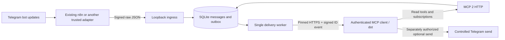

# Architecture

## Flow

The adapter authenticates Telegram at its own boundary and signs its exact forwarded JSON bytes. The connector checks the signature and time window before parsing. In one SQLite transaction it records the nonce/update, updates the retained message, and queues events for matching subscriptions. Queue overflow rolls back the entire ingestion so the adapter can retry.

`update_id` identifies a bot update. `(chat_id, message_id)` identifies a retained message. Edits use `edit_date` (or original date) and update ID to reject older versions; equivalent repeated message bodies do not produce another event. No global monotonic high-water mark is used because Telegram update IDs can reset after inactivity. Deduplication is bounded by retention and update count limits.

## Components

| File | Responsibility |
| --- | --- |
| `config.ts` | Fail-closed environment parsing, separate credentials, scope lists |
| `security.ts` | Constant-time comparisons, HMAC ingress, DNS/IP validation and pinned HTTPS |
| `store.ts` | SQLite schema, transactions, retained text, nonces, outbox and pruning |
| `events.ts` | Draft event schemas, callback challenge, subscription identity/rotation and delivery |
| `send.ts` | Durable send ledger, authorization and uncertain-outcome handling |
| `mcp.ts` | SDK tools and explicit custom event methods |
| `app.ts` / `main.ts` | HTTP guards, request bounds, lifecycle and periodic worker |

## Durability and limits

SQLite uses WAL, foreign keys, secure deletion and a busy timeout. The parent directory is created with mode 0700 and database mode 0600; the executable sets umask 0077. One instance must own the database. The worker is single-flight and processes at most 25 due jobs per pass. This is deliberately not a distributed queue.

Default retention is seven days, configurable from one to 90. Maintenance removes old retained messages, updates and jobs; keeps at most 50,000 messages and 100,000 update receipts; expires nonces after ten minutes; removes expired/revoked subscriptions and their jobs. Pruning runs on startup and between worker passes, so these are operational bounds with a short maintenance lag. Message retention is measured from receipt of its latest retained version. Late source versions older than the retention window are ignored.

There are at most 100 subscriptions and 10,000 queued/dead jobs. The send ledger stores hashes and Telegram result IDs, not outgoing text; its 100,000-record limit fails closed rather than deleting keys and risking duplicate sends. Database allocation and external backups need operator disk limits and retention: deleting rows is not a guarantee of physical erasure from snapshots or SSDs.

A job has a stable event ID and serialized body. Transient network errors, HTTP 408/429 and 5xx get up to eight attempts with exponential backoff and jitter. Other errors become dead jobs; 410 cancels the subscription. Successful jobs are deleted. Crash after receiver acceptance can repeat an event: delivery is at least once. Events missed outside an active subscription cannot be replayed by the protocol.

A Telegram send is recorded as unknown before network I/O. Success stores its result; a timeout, rejection or crash leaves unknown state. Retrying the same key returns that state without sending again. Different content with an existing key is rejected. An operator must reconcile uncertain outcomes; the service cannot provide exactly-once delivery through Telegram.

## MCP compatibility

The installed `@modelcontextprotocol/server` 2.4.0 implements the 2026-07-28 protocol. Tools and HTTP envelopes are handled by the SDK. Events methods are registered through its documented custom-method API. Its TypeScript `ServerCapabilities` type does not yet include the draft `events` property; one localized intersection type advertises it. A wire-level test verifies it survives discovery. No patched SDK or handwritten replacement transport is used.

Only modern MCP is enabled. Request version/client metadata and HTTP method/version/name headers must match the MCP 2 specification. `events.ts` remains the replaceable compatibility boundary if the draft changes. The local suite tests discovery, tool calls and event subscriptions; account-specific client acceptance remains an integration gate.
