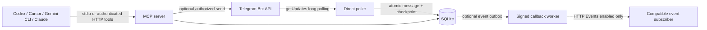

# Architecture

The default local mode is stdio plus direct polling. A client launches one process; EOF or SIGINT/SIGTERM cancels outbound work, closes transport/storage and releases its database lock. For simultaneous clients, use one long-running HTTP process. No model API or workflow service participates.

## Direct ingestion

Before polling, `getMe` binds the database to a bot ID and `getWebhookInfo` checks that polling will not replace a webhook. Another bot identity is refused. Token rotation for the same bot does not reset state. Nothing calls `setWebhook` or `deleteWebhook`.

`getUpdates` asks for batches of at most 100 with a 25-second timeout. Responses have a 4 MiB limit; network requests have bounded DNS/request deadlines and an abort signal. Supported update types are new/edited messages and channel posts. Unknown types are acknowledged without retained content. Disallowed chats advance the checkpoint without retaining their message data.

Each update transaction stores its receipt, newest message version, optional outbox jobs, and next polling offset. A later `getUpdates` call acknowledges only committed updates. If a batch has invalid ordering it is rejected before processing; malformed content stops at the offending update, retaining earlier committed progress. Queue pressure rolls back the update and checkpoint together. Rate limits and transient failures retry with bounded backoff; permanent API errors/conflicts stop the process. There is no silent drop-on-error path.

After seven days without a committed update, the saved offset is omitted because Telegram can restart update numbering after inactivity. Source deduplication remains bounded by retention. The database is for one bot/update stream; changing bot identity needs a separately managed database. Migration from v1 adds only a metadata table/checkpoint and preserves existing state. Historical adapter data has no verifiable bot identity, so operators must confirm its origin before first binding it or start a new database.

## Components

| Module | Responsibility |
| --- | --- |
| `config.ts` | Transport/mode selection, credentials and allowlists |
| `telegram.ts` | Fixed Bot API methods, preflight, batch polling and retry classification |
| `store.ts` | Schema v2, retention, messages, poll checkpoint, event outbox and send ledger |
| `runtime.ts` / `main.ts` | Startup rollback, stdio/HTTP lifecycle, cancellation and workers |
| `lock.ts` | Exclusive database lock with explicit stale-lock recovery |
| `mcp.ts` | Shared standard tool factory; Events only on enabled modern HTTP connections |
| `events.ts` | Optional draft Events schemas, verification, signing, TTL, retries |
| `app.ts` / `security.ts` | Loopback guards, bearer auth, optional signed ingress, pinned HTTPS |

## MCP compatibility

The official server SDK 2.4.0 serves both 2025 initialization and 2026-07-28 discovery. `serveStdio` owns negotiation for a connection; `createMcpHandler` owns modern HTTP requests and stateless legacy fallback. The same tool factory serves both. No handwritten replacement transport or patched SDK is used. HTTP requests are individually authenticated; no session affinity is required.

Events registration is gated by configuration and modern protocol era. Its draft capability needs one localized TypeScript intersection because the installed SDK's capabilities type does not yet name it. Standard tools never require this extension. With Events disabled, new jobs are not enqueued and old jobs are not sent; expired state is still pruned. Re-enabling before expiry may resume old jobs.

## State and resource limits

SQLite uses WAL, foreign keys, secure deletion and busy timeout. Main sets umask 0077, creates private state directories and uses a 0600 database/lock. An exclusive lock file prevents two runtime processes from opening one state store. A crash can leave the lock; do not remove it until its recorded PID/process is verified absent. Different databases do not prevent two pollers from conflicting for the same bot; Telegram 409 is fatal.

Defaults: seven-day retention (configurable 1–90), 50,000 messages, 100,000 update receipts, 100 subscriptions and 10,000 queued/dead jobs. Pruning runs at startup and between worker passes, so count limits have a short maintenance lag. Nonces from optional adapter mode expire after ten minutes. Message retention is based on latest retained receipt. Physical disk allocation/backups require separate quotas and retention.

Optional event delivery is at least once: stable IDs/bodies, fresh signatures, bounded retries, no historical replay. Sends persist an unknown outcome before network I/O and store result IDs only on success. Unknown results never auto-retry; the 100,000-key send ledger fails closed rather than deleting keys. See security/operations for reconciliation limits.
